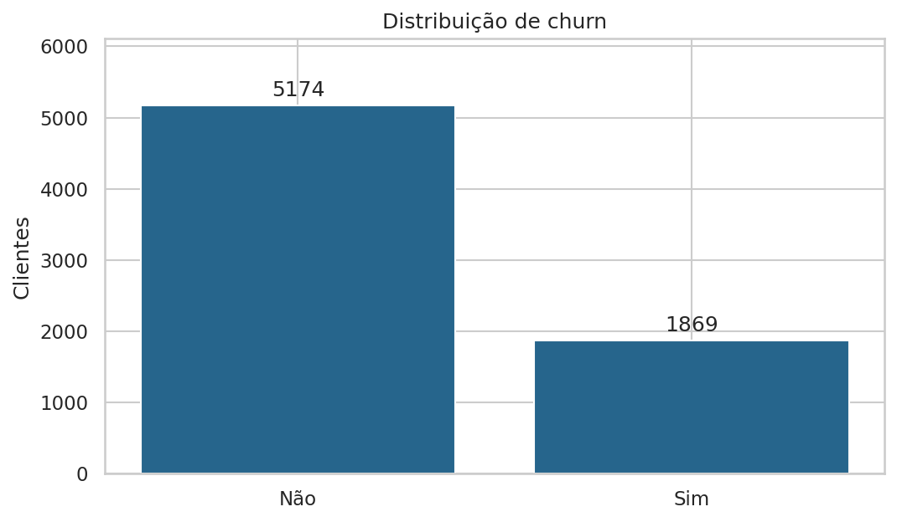
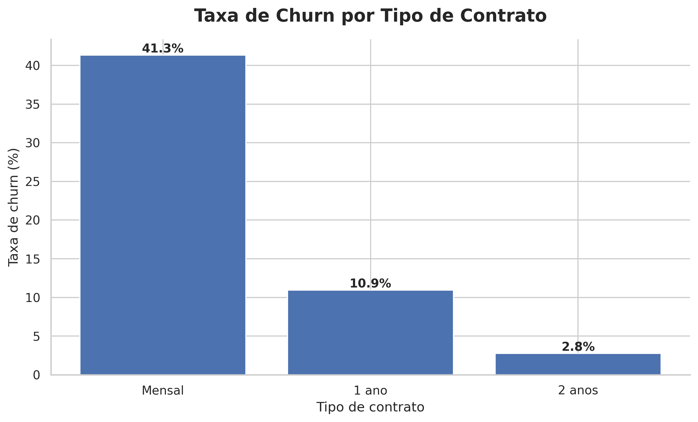
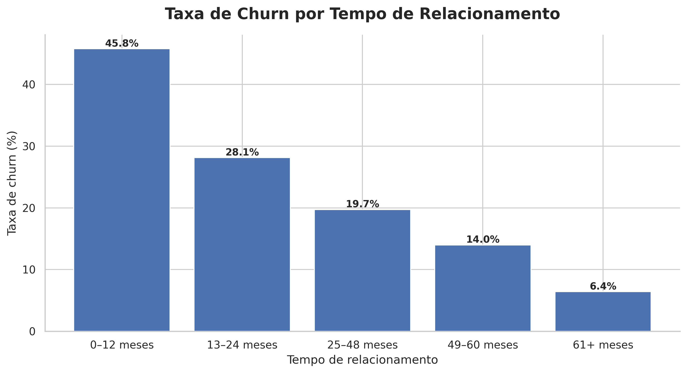

# 📡 Telecom X BR I — Análise de Churn

> **ETL, Análise Exploratória de Dados e Business Insights para investigar os fatores associados à evasão de clientes em uma empresa de telecomunicações.**


---

## 💼 Sobre o Projeto

O **Telecom X BR I** é um projeto de Data Science desenvolvido para investigar os fatores associados ao **churn (evasão de clientes)** em uma empresa de telecomunicações.

A solução utiliza **Python e Análise Exploratória de Dados (EDA)** para extrair, transformar e analisar informações provenientes de uma API, buscando identificar padrões relacionados ao comportamento dos clientes e gerar insights que possam apoiar estratégias de retenção.

O projeto foi desenvolvido durante a **Tech Foundation — Especialização Data Science**, integrante do programa **Oracle Next Education (ONE) G9 BR / Alura**.

---

## 🎯 Objetivo

Investigar os principais fatores associados à evasão de clientes por meio de técnicas de:

- extração de dados;
- limpeza e transformação;
- análise exploratória;
- visualização de dados;
- análise de correlação;
- interpretação de indicadores;
- geração de insights de negócio.

O objetivo é transformar dados brutos em evidências que possam apoiar decisões relacionadas à **retenção e gestão do relacionamento com clientes**, além de preparar a base para uma etapa posterior de Machine Learning.

---

## 💼 Problema de Negócio

A evasão de clientes representa um desafio relevante para empresas que operam com modelos de receita recorrente.

Compreender quais características aparecem associadas a uma maior incidência de cancelamento pode ajudar a orientar iniciativas relacionadas a:

- retenção;
- fidelização;
- onboarding;
- precificação;
- cross-selling;
- relacionamento com clientes.

O projeto utiliza análise de dados para identificar padrões e segmentos que merecem maior atenção do negócio.

---

## 🔄 Pipeline de Dados

```text
API / JSON
     ↓
Extração dos Dados
     ↓
Tratamento e Padronização
     ↓
ETL
     ↓
Análise Exploratória
     ↓
Análise de Churn
     ↓
Correlação entre Variáveis
     ↓
Visualizações
     ↓
Insights
     ↓
Recomendações de Negócio
```

---

## 🔬 Etapas do Projeto

### 1. Extração

Importação dos dados provenientes da fonte disponibilizada para o desafio.

### 2. Transformação

Preparação dos dados para análise, incluindo:

- tratamento de inconsistências;
- padronização das informações;
- conversão de tipos;
- preparação das variáveis;
- criação de atributos necessários às análises.

### 3. Análise Exploratória

Exploração estatística e visual das principais características da base para compreender sua distribuição e comportamento.

### 4. Análise de Churn

Comparação entre o comportamento dos clientes que permaneceram na empresa e daqueles que deixaram o serviço.

### 5. Correlação entre Variáveis

Investigação das relações existentes entre diferentes características dos clientes e a ocorrência de churn.

### 6. Business Insights

Transformação dos resultados analíticos em hipóteses e recomendações que possam apoiar decisões de negócio.

---

## 📊 Principais Resultados

### Distribuição de Churn



A análise identificou uma **taxa geral de churn de 25,7%**, com 1.869 clientes que cancelaram o serviço entre os 7.267 registros analisados. O resultado evidencia uma parcela relevante da base sujeita à evasão e reforça a necessidade de identificar os segmentos de maior risco.

### Churn por Tipo de Contrato



O tipo de contrato apresenta uma das diferenças mais expressivas da análise. Clientes com **contrato mensal registram churn de 41,3%**, enquanto contratos de **1 ano apresentam 10,9%** e contratos de **2 anos apenas 2,8%**.

Esse comportamento sugere forte associação entre **maior compromisso contratual e retenção**, tornando clientes de contratos mensais um segmento prioritário para estratégias de fidelização.

### Churn por Tempo de Relacionamento



O churn também diminui significativamente à medida que aumenta o tempo de relacionamento com a empresa:

- **0–12 meses:** 45,8%
- **13–24 meses:** 28,1%
- **25–48 meses:** 19,7%
- **49–60 meses:** 14,0%
- **61+ meses:** 6,4%

Os dados indicam que **os primeiros meses da jornada do cliente representam o período de maior risco de evasão**. Isso aponta para a importância de estratégias de onboarding, acompanhamento inicial e ações preventivas de retenção.

---

## 📊 Principais Insights

### 📉 Churn da base

A análise identificou **churn de aproximadamente 26% dos clientes**.

Esse resultado também indica a necessidade de atenção ao desbalanceamento da variável-alvo em uma eventual etapa de Machine Learning.

### 📃 Tipo de contrato

Clientes com contratos **Month-to-month** apresentam maior incidência de churn quando comparados aos clientes com contratos de maior duração.

Esse comportamento sugere que o tipo de contrato pode representar uma variável relevante para estratégias de retenção.

### ⏳ Tempo de relacionamento

Clientes com **menor tenure** concentram uma parcela relevante da evasão.

O resultado indica que os primeiros meses do relacionamento podem representar um período especialmente importante para ações de onboarding e retenção.

### 💰 Custo mensal

Foi observada uma tendência de maior churn entre clientes com **valores mensais mais elevados**, sugerindo possível sensibilidade à relação entre preço e valor percebido.

### 📦 Quantidade de serviços

Clientes que utilizam uma **maior quantidade de serviços** apresentam menor ocorrência de churn na análise realizada.

O comportamento observado sugere uma possível relação entre maior engajamento com o portfólio de serviços e retenção.

---

## 💡 Recomendações de Negócio

A partir dos padrões identificados, algumas iniciativas podem ser investigadas:

- fortalecer ações de **onboarding nos primeiros meses** do relacionamento;
- desenvolver estratégias para incentivar a migração de contratos **Month-to-month** para planos de maior duração;
- avaliar a percepção de valor dos clientes com **mensalidades mais elevadas**;
- incentivar a contratação de **serviços complementares** quando houver aderência ao perfil do cliente;
- desenvolver estratégias segmentadas de retenção para grupos com maior incidência de churn;
- utilizar os padrões identificados como base para uma futura estratégia de **predição de clientes em risco**.

> **Importante:** as recomendações representam hipóteses orientadas pelos padrões observados nos dados. As associações identificadas não estabelecem, isoladamente, relações de causalidade e devem ser validadas antes de qualquer implementação no negócio.

---

## 🛠️ Tecnologias Utilizadas

| Tecnologia | Aplicação |
|---|---|
| **Python** | Processamento e análise dos dados |
| **Pandas** | Manipulação, limpeza e transformação |
| **NumPy** | Operações numéricas |
| **Matplotlib** | Visualização de dados |
| **Seaborn** | Visualizações estatísticas |
| **Google Colab / Jupyter** | Desenvolvimento e execução do notebook |
| **API / JSON** | Fonte e estrutura dos dados |

---

## 📂 Estrutura do Projeto

```text
Telecom-X-BR-I/
│
├── Telecom_X_BR.ipynb
└── README.md
```

O notebook concentra o fluxo analítico do projeto, desde a preparação dos dados até a geração dos insights e recomendações.

---

## 💡 Competências Demonstradas

O projeto aplica conhecimentos e práticas relacionados a:

- Data Analytics;
- Data Science;
- ETL;
- Exploratory Data Analysis (EDA);
- Python;
- Pandas;
- Data Cleaning;
- Data Transformation;
- Data Visualization;
- análise de correlação;
- Customer Churn Analysis;
- Business Analytics;
- geração de insights;
- Data-Driven Decision Making;
- tradução de resultados analíticos para contexto de negócio.

---

## 🚀 Evolução do Projeto

A análise exploratória desenvolvida no **Telecom X BR I** estabelece a base para uma evolução natural em direção à modelagem preditiva:

```text
EDA
 ↓
Feature Engineering
 ↓
Preparação dos Dados
 ↓
Machine Learning
 ↓
Predição de Churn
 ↓
Avaliação do Modelo
 ↓
Identificação de Clientes de Risco
 ↓
Estratégias Preventivas de Retenção
```

A próxima etapa pode utilizar modelos de classificação para estimar a probabilidade de churn e identificar clientes com maior risco de evasão.

---

## ➡️ Telecom X II — Predição de Churn

O **Telecom X BR II** representa a evolução do estudo exploratório para uma abordagem de **Machine Learning**, utilizando os conhecimentos obtidos nesta primeira etapa como base para construção e avaliação de modelos preditivos.

[Acessar Telecom X BR II — Predição de Churn com Machine Learning](https://github.com/MCLG1661/Telecom-X-BR-II)

A segunda etapa exclui 224 registros sem target válido, utilizando 7.043 registros na modelagem. Por isso, a taxa de churn da análise exploratória e a taxa da base supervisionada possuem denominadores distintos.

---

## 👤 Autor

**Marcus Guedes**

Marketing • Gestão de Projetos • Data Analytics • Inteligência Artificial aplicada a negócios

- GitHub: [MCLG1661](https://github.com/MCLG1661)
- LinkedIn: [Marcus Guedes](https://www.linkedin.com/in/marcusguedes/)

---

## 🎓 Formação

Projeto desenvolvido durante a **Tech Foundation — Especialização Data Science**, integrante do programa **Oracle Next Education (ONE) G9 BR / Alura**.

---

⭐ Projeto de estudo e portfólio voltado à aplicação de **Data Analytics, EDA e Business Insights na análise de Customer Churn**.
